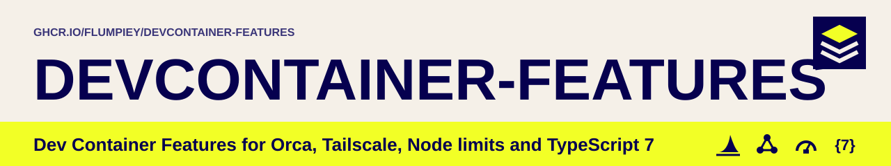

<picture>
  <source media="(prefers-&#99;olor-scheme: dark)" srcset="assets/banner-dark.svg">
  
</picture>

[](LICENSE)
[](https://github.com/flumpiey/devcontainer-features/actions/workflows/release.yaml)
[](scripts/verify.sh)
[](https://github.com/devcontainers/cli)
[](https://github.com/flumpiey?tab=packages&repo_name=devcontainer-features)

## What it is and why

Four Dev Container Features, published to `ghcr.io/flumpiey/devcontainer-features`. Each one replaces setup that a repo otherwise copies into its own `devcontainer.json` and scripts: an Orca server with pairing on the tailnet, a Tailscale join with a predictable hostname, memory and worker caps for Node tooling, and a TypeScript 7 CLI that leaves the repo's `tsc` alone. Every Feature is Bash, tested on Debian bookworm, Ubuntu jammy and Ubuntu noble.

## Features

- **orca-server** installs Orca (`orca-ide`) from a SHA-256 checked `.deb`, starts it at container start and waits for Tailscale to report `Running`.
- **orca-server** prints the desktop pairing link and the mobile QR code at each attach, and `orca-server show` prints them again.
- **orca-server** keeps the pairing grant in the volume `orca-server-data-${devcontainerId}`, so a rebuild keeps paired clients.
- **orca-server** serves with `--refuse-public`, and its install stops when the remote user is root.
- **tailnet** runs `tailscale up` with Tailscale SSH, tags and the hostname `<prefix>-<folder>-dev` at each start, in the background, so a failed join never blocks container start.
- **tailnet** reads the auth key from a container variable at start, so the key never enters an image layer.
- **node-guard** sets `NODE_OPTIONS`, `NX_PARALLEL`, `NX_DAEMON` and `VITEST_MAX_WORKERS` in the image environment, so every process gets them.
- **ts7-cli** installs TypeScript 7 in its own prefix as `tsc7`, with no `tsc` on `PATH`.
- Each install stops with one error line on any base other than Debian 12, Ubuntu 22.04 or Ubuntu 24.04 on amd64.

## Quick start

Add the Features to `.devcontainer/devcontainer.json`:

```json
{
  "image": "mcr.microsoft.com/devcontainers/base:bookworm",
  "features": {
    "ghcr.io/flumpiey/devcontainer-features/node-guard:1": {},
    "ghcr.io/flumpiey/devcontainer-features/ts7-cli:1": {}
  }
}
```

Start the container and check the result:

```bash
npx --yes @devcontainers/cli@0.88.0 up --workspace-folder .
npx --yes @devcontainers/cli@0.88.0 exec --workspace-folder . tsc7 --version
npx --yes @devcontainers/cli@0.88.0 exec --workspace-folder . printenv NODE_OPTIONS
```

The second command prints `Version 7.0.2`. The third prints `--max-old-space-size=2048`.

## Feature reference

| Id | Version | Options (default) | Usage |
|---|---|---|---|
| `orca-server` | 1.1.1 | `version` (`1.4.271`), `pairingAddress` (empty: Tailscale DNS name), `port` (`6768`), `mobilePairing` (`true`), `autoStart` (`true`), `showPairingOnAttach` (`true`), `tailscaleWaitSeconds` (`120`), `debSha256` (digest of 1.4.271) | `"ghcr.io/flumpiey/devcontainer-features/orca-server:1": {}` with `"ghcr.io/tailscale/codespace/tailscale": {}` |
| `tailnet` | 1.0.0 | `hostnamePrefix` (empty: `HOSTNAME_PREFIX`), `tags` (`tag:devcontainer`), `authKeyVar` (`TS_AUTH_KEY`), `ssh` (`true`) | `"ghcr.io/flumpiey/devcontainer-features/tailnet:1": {}` plus `runArgs` and `containerEnv` below |
| `node-guard` | 1.0.0 | None. Override a value in `remoteEnv`. | `"ghcr.io/flumpiey/devcontainer-features/node-guard:1": {}` |
| `ts7-cli` | 1.0.0 | `version` (`7.0.2`) | `"ghcr.io/flumpiey/devcontainer-features/ts7-cli:1": { "version": "7.0.2" }` |

Each Feature has a `NOTES.md` with the full detail: [orca-server](src/orca-server/NOTES.md), [tailnet](src/tailnet/NOTES.md), [node-guard](src/node-guard/NOTES.md), [ts7-cli](src/ts7-cli/NOTES.md).

### orca-server

```json
{
  "image": "mcr.microsoft.com/devcontainers/base:bookworm",
  "remoteUser": "vscode",
  "features": {
    "ghcr.io/tailscale/codespace/tailscale": {},
    "ghcr.io/flumpiey/devcontainer-features/orca-server:1": {}
  }
}
```

| Command | Result |
|---|---|
| `orca-server start` | Starts Orca in the background. Exit 0 also when it already runs. |
| `orca-server stop` | Stops Orca. Exit 0. |
| `orca-server status` | Prints `running` (exit 0) or `stopped` (exit 3). |
| `orca-server url [--mobile]` | Prints one pairing link. Exit 1 when Orca is not running. |
| `orca-server show [--attach]` | Waits for Orca, then prints both links and the QR code. |

Treat a pairing link like a password. Anyone who reads it and can reach the server can pair. Attach output can stay in Dev Containers, Codespaces or CI logs, so set `showPairingOnAttach` to `false` where attach output is logged. [NOTES.md](src/orca-server/NOTES.md#revoke-old-links) shows how to revoke unused links.

### tailnet

A Feature cannot add a device or read a host variable, so the repo adds `runArgs` and `containerEnv`:

```json
{
  "image": "mcr.microsoft.com/devcontainers/base:bookworm",
  "runArgs": ["--device=/dev/net/tun"],
  "containerEnv": {
    "TS_AUTH_KEY": "${localEnv:TS_AUTH_KEY}",
    "HOSTNAME_PREFIX": "${localEnv:HOSTNAME_PREFIX}"
  },
  "features": {
    "ghcr.io/flumpiey/devcontainer-features/tailnet:1": {}
  }
}
```

The tailnet policy must define the tags and let the key own them. The result of each join is in `/var/log/tailnet.log`.

## Configuration

Container variables that the Features read or set. Feature options are in the table above.

| Name | Required | Default | Purpose |
|---|---|---|---|
| `TS_AUTH_KEY` | For tailnet, when the node is not logged in | None | Tailscale auth key, read at container start. Set it on the host as `<your-auth-key>`. `authKeyVar` changes the name. |
| `HOSTNAME_PREFIX` | No | Empty | Hostname prefix for tailnet when `hostnamePrefix` is empty. Empty gives `<folder>-dev`. |
| `TAILNET_WORKSPACE` | No | The single directory under `/workspaces` | Folder part of the tailnet hostname. Set it to `${containerWorkspaceFolderBasename}` for another workspace folder. |
| `NODE_OPTIONS` | No | `--max-old-space-size=2048` (node-guard) | Node heap cap per process. A `remoteEnv` value replaces the whole string. |
| `NX_PARALLEL` | No | `1` (node-guard) | Nx tasks at a time. |
| `NX_DAEMON` | No | `false` (node-guard) | Nx daemon on or off. |
| `VITEST_MAX_WORKERS` | No | `1` (node-guard) | Vitest worker count. |

## Development

The checks need `shellcheck`, `shfmt`, `jq` and `git`. The `ci` mode also needs Docker and Node for `npx`.

```bash
pnpm install                # installs the lefthook pre-commit and commit-msg hooks
bash scripts/verify.sh fast # shellcheck, shfmt, JSON, default pins, style scan
bash scripts/verify.sh push # fast, then each Feature's default test on bookworm
bash scripts/verify.sh ci   # fast, then every test and scenario on bookworm, jammy and noble
```

A push to `main` runs the tests and publishes each changed Feature version to GHCR.

## Licence

MIT. See [LICENSE](LICENSE).

---

Built by Dru Connold. [flumpiey.github.io](https://flumpiey.github.io) and [malvadev.com](https://malvadev.com).
